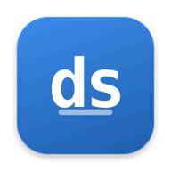
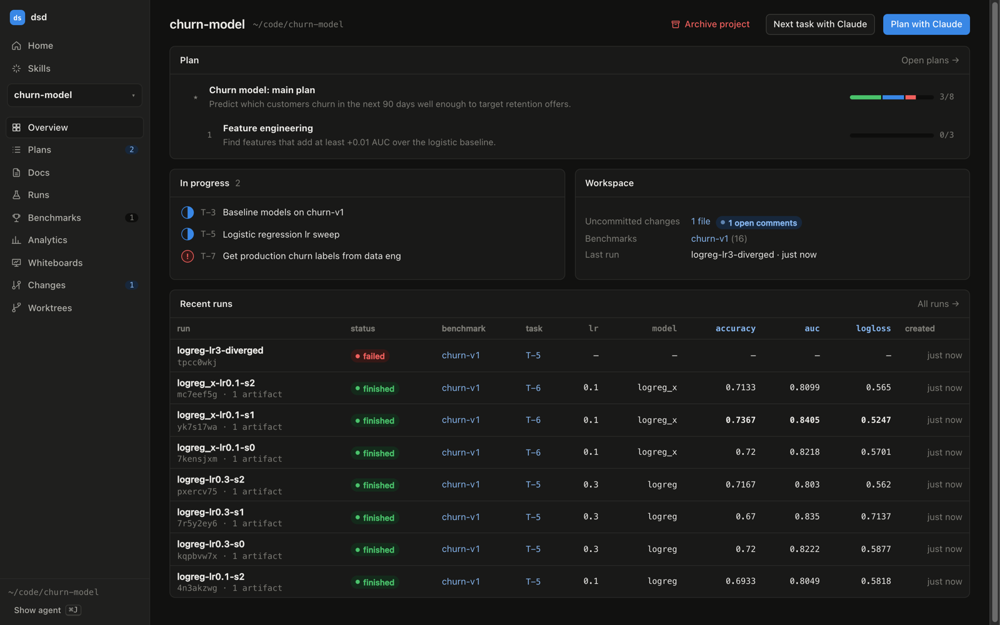
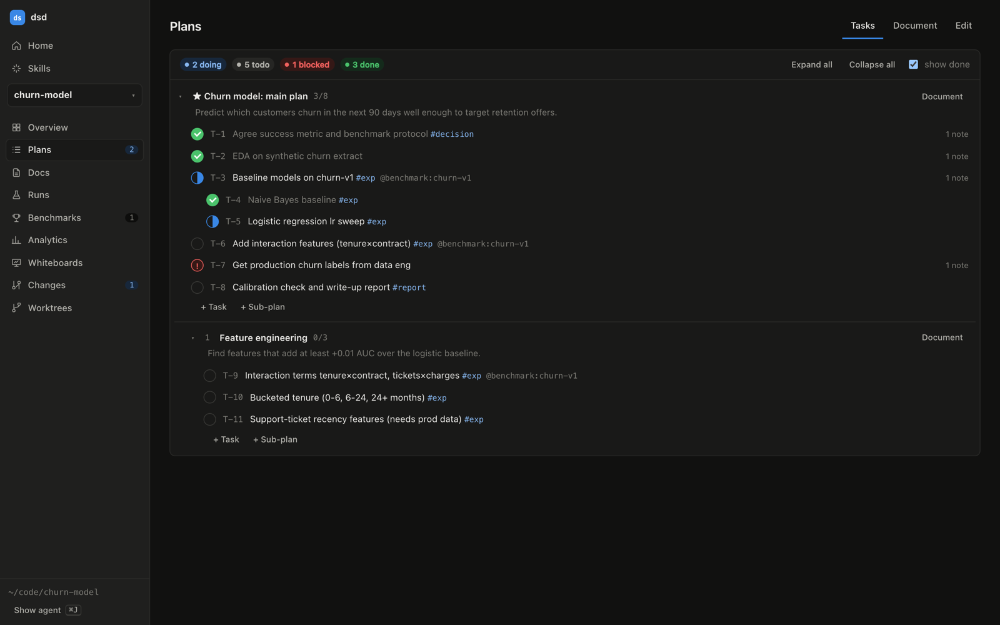
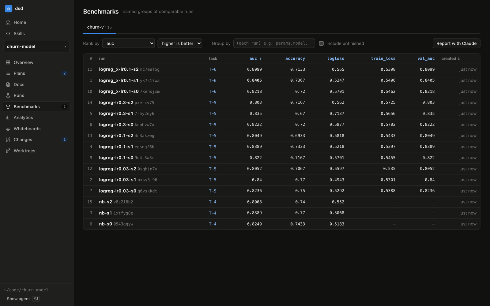
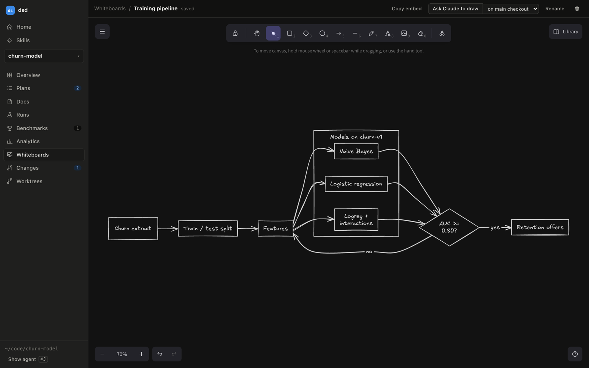
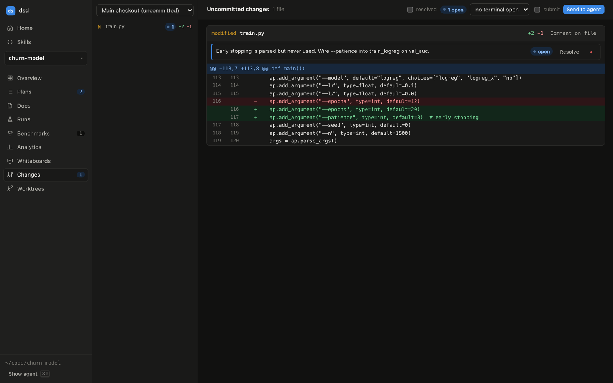
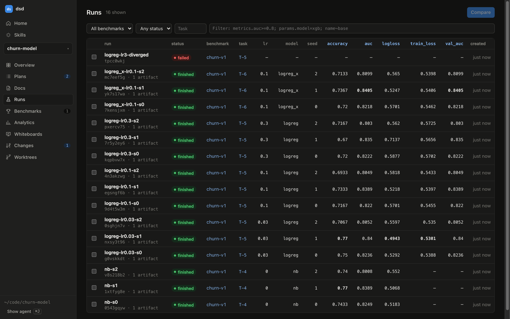
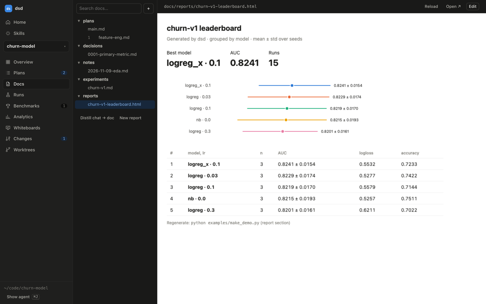

<p align="center">
  
</p>

<h1 align="center">dsd</h1>

<p align="center">
  <b>A workspace for agent–data science collaboration.</b><br>
  Plans, experiment tracking, benchmarks, docs and whiteboards, shared by you and Claude Code.
</p>

<p align="center">
  <a href="LICENSE"></a>
  
  
  
</p>

<p align="center">
  
</p>

## Why dsd

Coding agents are good at writing code, but data science is more than code. It's a long run of experiments, numbers and decisions: what you tried, what won on the benchmark, why you picked one metric over another. That context usually lives in your head, a notebook or a chat that has already scrolled away, so an agent starts every session without it.

dsd gives you and your agent the same project memory:

- **A plan you agree together.** The agent drafts it with you, then works through tasks with ids like `T-12`.
- **Experiments that remember themselves.** Every run records its parameters, metrics, git state and outputs, tagged with the task it serves.
- **Benchmarks** that rank runs, so "is this better?" has one answer.
- **Docs, reports and whiteboards** for decisions, write-ups and diagrams. Claude can write and draw them, and you can edit them.
- **A local app** where you watch, review and steer: plans, runs, leaderboards, diffs and the agent's own terminal, side by side.

Claude Code reaches all of this through dsd's MCP server and skills. When you say "pick up the next task" or "post the results", it knows the plan, the benchmark and what was tried before.

## Features

| | |
|---|---|
| **Plans** | Markdown checklists with project-wide task ids (`T-12`): one central plan plus sub-plans, shown as a task board or a document. |
| **Experiment tracking** | `dsd exec -- python train.py` tracks any script with no code changes, or use `dsd.run(...)` from Python. Each run stores params, metrics, artifacts, the git commit (and diff, if the tree was dirty), the command and dataset references. |
| **Benchmarks** | Named groups of comparable runs, ranked on a primary metric. Grouped leaderboards show mean ± std across seeds. |
| **Docs and reports** | Decisions, notes and HTML reports with live run tables, Mermaid charts and embeds. Full-text search for you and for Claude. |
| **Analytics** | A feed of key results: a headline number, metrics against a baseline, a chart, and links to the task and runs. |
| **Whiteboards** | Excalidraw boards per project. Claude can draw on them from a Mermaid diagram or placed shapes, and you can edit the result. |
| **Agent sessions** | Claude Code and shell terminals inside the app. Each session can get its own git worktree, so parallel agents never edit the same checkout. |
| **Review** | See a worktree's whole branch as a diff, leave comments and send them to its agent, then commit or merge from the app. |
| **Home** | An agenda across projects: to-dos with natural-language dates, blocked tasks, failed runs, recent docs and your Claude Code usage. |
| **Outside your repo** | All project state lives in `~/.dsd/`. dsd never writes into your repo, so it works on any codebase, including a shared monorepo. |

<table>
  <tr>
    <td></td>
    <td></td>
  </tr>
  <tr>
    <td align="center"><b>Plans</b>: tasks, status and notes</td>
    <td align="center"><b>Benchmarks</b>: runs ranked on a primary metric</td>
  </tr>
  <tr>
    <td></td>
    <td></td>
  </tr>
  <tr>
    <td align="center"><b>Whiteboards</b>: diagrams you and Claude both edit</td>
    <td align="center"><b>Changes</b>: review and comment on the agent's work</td>
  </tr>
  <tr>
    <td></td>
    <td></td>
  </tr>
  <tr>
    <td align="center"><b>Runs</b>: filter, sort and compare</td>
    <td align="center"><b>Reports</b>: self-contained HTML in your docs</td>
  </tr>
</table>

## Working with Claude

A typical loop, from the app or from Claude Code in your own terminal:

1. **Plan:** `/dsd-plan` works out the goal, the requirements and how to check each one (tests, a benchmark) with you, then writes the plan and its tasks.
2. **Build:** on a task, **Work on this in a worktree** starts Claude in that task's own worktree with `/dsd-develop T-6`. It checks the task against recent PRs and code, shows you an HTML explainer of what will change, then builds it.
3. **Experiment:** runs are tagged with their task (`dsd exec --task T-6 ...`) and land on the benchmark's leaderboard.
4. **Report:** `/dsd-results` posts the headline numbers to Analytics. `/dsd-report` builds a full HTML report, and `/dsd-distill` turns a discussion into a decision record.
5. **Review:** read the branch in **Changes**, send comments to the agent, then merge the worktree.

### Skills

dsd installs these Claude Code skills and keeps them up to date. It leaves alone any skill you've edited.

| Skill | What it does |
|---|---|
| `/dsd-plan` | Plans a piece of work with you: a step-by-step design doc with agreed requirements and checks, then tasks. |
| `/dsd-develop` | Picks up the next task, checks it against recent PRs and code, shows an HTML explainer of the change, then builds it. |
| `/dsd-run-experiment` | Runs and tracks an experiment, then compares it with the benchmark leaderboard. |
| `/dsd-benchmark` | Records a finished benchmark run (often an HTML or JSON dump) with key metrics and links to its outputs. |
| `/dsd-results` | Posts key results to the Analytics page. |
| `/dsd-report` | Builds a self-contained HTML analysis report from runs. |
| `/dsd-distill` | Turns the conversation into a decision record or research note. |
| `/dsd-review` | Reviews a GitHub PR: a summary, your focus areas, then an HTML explainer with diagrams and charts. |

### MCP tools

The `dsd` MCP server gives Claude:
- the project overview, plans and tasks;
- docs: list, search, read and write;
- runs and benchmarks: query, compare, add, update and read artifacts;
- Analytics posts, whiteboards (list, read, draw) and review comments;
- your cross-project to-dos, and renaming its worktree.

Each tool is a thin wrapper over the functions the CLI and the app use.

Sessions started from the app get dsd's tools and skills automatically. To use them in Claude Code anywhere else, click **Connect Claude Code** on Home or run `dsd setup`.

## Install

dsd is alpha software, developed and tested on macOS. Linux should work but is untested. You need **git**, and for the agent features **[Claude Code](https://docs.claude.com/en/docs/claude-code)**, installed and logged in.

**Mac app (Apple Silicon), with Homebrew:**

```sh
brew install --cask fchmiel/dsd/dsd
```

This installs `dsd.app` and the `dsd` command, with the backend bundled, so you don't need Python or Node. The app isn't notarized yet; the cask clears macOS's quarantine flag so it opens normally. You can also download the DMG from [Releases](https://github.com/FChmiel/dsd/releases).

**Any OS, as a command-line tool:** install the wheel from a release with `uv tool install <wheel URL>`.

**From source:** you need **Python 3.11+**, **[uv](https://docs.astral.sh/uv/)** and **Node 18+**.

```sh
git clone https://github.com/FChmiel/dsd.git && cd dsd
(cd ui && npm ci && npm run build)   # builds the web UI into src/dsd/web/dist
uv tool install .                    # puts `dsd` on your PATH
```

How releases are made: [docs/distribution.md](docs/distribution.md).

## Quick start

```sh
cd ~/code/my-repo
dsd init        # starts a project for this repo; its state goes in ~/.dsd/projects/<id>/
dsd ui          # opens the app at http://127.0.0.1:8765
dsd setup       # optional: gives Claude Code outside the app dsd's MCP tools and skills
```

Then click **Plan with Claude** on the project's Overview, or **+ New session** to start Claude in its own worktree.

### Try the demo

The demo builds a toy churn-model project with a plan, docs, 16 tracked runs, a benchmark, a report, a whiteboard and a pending change with a review comment:

```sh
uv run python examples/make_demo.py   # creates .demo/churn-model
dsd ui .demo/churn-model
```

## Tracking experiments

Track any command, with no code changes:

```sh
dsd exec -b churn-v1 --task T-3 -- python train.py --lr 0.1
dsd bench set churn-v1 --primary auc --direction max
dsd bench board churn-v1 -g params.model,params.lr   # leaderboard, mean ± std per group
```

Or log from Python:

```python
import dsd

with dsd.run("xgb", benchmark="churn-v1", task="T-3", params=cfg,
             datasets=[dsd.dataset(id="churn-2024q3", config="configs/data.yml")]) as r:
    r.log({"loss": loss}, step=epoch)
    r.log({"auc": auc})
    r.html("eval.html", html)
```

Record a run that happened elsewhere, for example a benchmark that dumped its results to HTML:

```sh
dsd runs add "solver-v2 full estate" -b estate --metric cost=1234.5 --metric hours=812 \
  --link results=s3://bucket/run-7/ --artifact results.html --commit HEAD --at 2026-11-18
```

## Plans and tasks

```sh
dsd plan show                                   # the central plan
dsd task add "Try LightGBM" --tag exp --attr benchmark=churn-v1
dsd task start T-4 ; dsd task done T-4 -m "AUC 0.84, run 3ax47yw7"
dsd plan new feature-eng --title "Feature engineering"
```

Plans are plain markdown: `- [ ] T-4 Try LightGBM #exp @benchmark:churn-v1`.
- The markers are `[ ]` todo, `[/]` doing, `[x]` done, `[!]` blocked and `[-]` dropped.
- dsd's edits only change the characters they need to, so the files stay friendly to hand edits and diffs.
- Add a `Task: T-4` trailer to a commit to link it to its task.

## Worktrees: one agent per branch

By default **+ New session** starts Claude in a new git worktree on branch `dsd/<name>`, so parallel agents never collide. The launcher can also use an existing worktree or the main checkout.

- Worktrees live in `~/.dsd/worktrees/<project>/<name>`. dsd lists only the worktrees it created or you adopted (`dsd wt adopt <path>`), so a big repo's other worktrees stay out of the way.
- Local files such as `.env` are copied into each new worktree, and an optional setup command runs before the agent starts.
- Plans, docs and runs are shared by every worktree. Runs made in a worktree are tagged with it.
- **Worktrees** shows ahead/behind and dirty status for each one, and lets you commit, merge (merge commit or squash) or remove it.

```toml
# ~/.dsd/projects/<id>/project.toml
[worktree]
setup = "uv sync"
copy = [".env", "data/local.parquet"]
```

```sh
cd "$(dsd wt new --task T-6)"          # a worktree named after the task
dsd wt ls                              # --all also lists worktrees you could adopt
dsd wt merge t-6-add-interaction-features --squash
dsd wt rm sharp-orca --delete-branch
```

## Home and to-dos

Home pulls everything together across projects:
- an agenda of your to-dos and dated tasks;
- what needs you: blocked tasks, worktrees to merge, failed runs and unsent review comments;
- recent docs, and your Claude Code usage.

Quick add understands dates and projects: `Send the AUC numbers to the team fri #churn-model`. Claude can manage to-dos too ("remind me to email the data team on Friday").

```sh
dsd today
dsd todo add Send the AUC numbers fri #churn-model
dsd todo done T-3 ; dsd todo move T-4 next week
```

## Where things live

dsd stores nothing in your repo: no `.dsd/` folder, no `CLAUDE.md` or `.gitignore` edits, no `.mcp.json`.

```
~/.dsd/projects/<id>/
  project.toml        # name, repo path, optional scope, [worktree], [[backup]]
  docs/               # plans/, decisions/, notes/, reports/, experiments/, analytics/, whiteboards/
  runs/  index.db     # run bundles and their SQLite index
  benchmarks.toml  review.json  worktrees.json
```

dsd finds the project from the repo root, any subdirectory or any of the repo's git worktrees. To run several projects in one monorepo, give each a scope (`dsd init --name pricing --scope services/pricing`); the most specific scope wins.

| Variable | Effect |
|---|---|
| `DSD_HOME` | Where dsd keeps its state (default `~/.dsd`). |
| `DSD_PROJECT_ROOT` | Overrides the project lookup for the CLI, the SDK and the MCP server. |
| `DSD_CLAUDE_CMD` | The command the app runs for Claude sessions (default: `claude` on your login-shell PATH). |

Housekeeping:
- `dsd archive` hides a project and removes its dsd worktrees. Branches, docs and runs are kept, and `dsd restore` brings everything back.
- `dsd backup add-local <folder>` snapshots docs (and optionally runs) to a folder, for example in iCloud Drive or Dropbox.

## Development

```sh
uv sync && uv run pytest                 # Python tests
cd ui && npm install && npm run dev      # UI dev server on :5173, proxied to `dsd ui --no-open` on :8765
cd ui && npm run build                   # builds into src/dsd/web/dist, which `dsd ui` serves
cd ui && npm run notices                 # regenerates THIRD_PARTY_NOTICES.md after dependency changes
```

The code is split into:
- `src/dsd`: the Python package (CLI, SDK, MCP server and FastAPI app);
- `ui/`: the web UI (React and Vite);
- `app/`: the Tauri desktop shell;
- `packaging/`: the Mac app build.

Release and signing: [docs/distribution.md](docs/distribution.md).

Issues and pull requests are welcome.

## Roadmap

- Signed and notarized Mac builds, auto-update, and the Python package on PyPI.
- Importing runs from SageMaker and S3 (the run format already has `backend` and `external_id` fields for it).
- Git and S3 backup targets, alongside local snapshots.
- Distilling past Claude transcripts into docs (today `/dsd-distill` works on the live conversation).
- A Marimo notebook pane.

## License

MIT, see [LICENSE](LICENSE). The web UI bundles open-source packages and fonts under their own licences, listed in [THIRD_PARTY_NOTICES.md](THIRD_PARTY_NOTICES.md).
