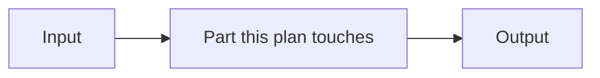
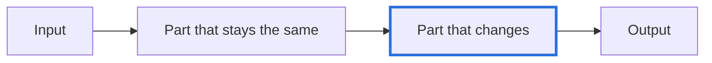
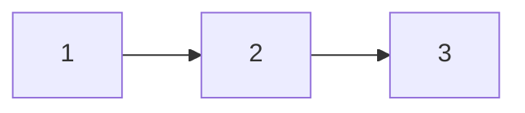

# <Title>

## 1. Goal

<Two or three sentences. What will be true when this is done, and why it matters. Name the user or the metric that changes.>

## 2. Requirements

What must be true when this is done, and how we check it. Agreed with the user.

| ID | Requirement | How we check it | Target | Benchmark |
|---|---|---|---|---|
| R1 | <one sentence> | <test, benchmark metric, query, or manual check by whom> | <threshold and direction> | <name or —> |

Baseline: <benchmark run ids on the current code, or the step that records them>.

## 3. What is there today

Read at commit `<sha>` on <YYYY-MM-DD>.

<How the code works today, with file and line references. Group by area. For each, say what it does and where.>

<One sentence: what to notice in the diagram.>

### Gotchas

<What an agent would not spot by reading the code: hidden callers, config that overrides code, data quirks, tests that pass for the wrong reason, environment traps.>

## 4. Decisions this rests on

- **0001** <one line: the question and the answer, or "open: recommend X">

## 5. What changes

<The design. What is added, moved or changed, and how the parts fit.>

<One sentence: what changes and why it matters. Embed an explainer with ![[designs/<slug>.html]] if a picture is not enough.>

## 6. What does not change

<What every step must leave alone: public APIs, outputs that must stay identical, schemas, behaviour for other users. Be specific; reviewers check against this.>

## 7. Risks and rollout

| Risk | How likely | What we do about it |
|---|---|---|
| | | |

<How it reaches production: flags, who gets it first, how to roll back.>

## 8. Delivery plan

| # | Change (one sentence) | Done when | Size (est) | Safe to ship because | Stack | Task | PR |
|---|---|---|---|---|---|---|---|
| 0 | The user reviews this plan | Plan agreed | — | No code | — | — | — |
| 1 | | <R ids and checks, e.g. "R2: p95 < 30 s on estate; tests in test_x.py pass"> | | | | | |
| n | Check all requirements are met | R1 to R<n> met, results recorded | — | No code | — | | — |

### Sample descriptions

**Step 1: <title>**

<One or two plain-language paragraphs, as the reviewer will read them.>

## 9. How we know it worked

<How the checks in section 2 are run: the commands, benchmarks and dashboards, and anything checked in production after release.>

## 10. Open questions

- <Question> (who can answer it)

## Change log

- <YYYY-MM-DD> Wrote the plan.

## Tasks

